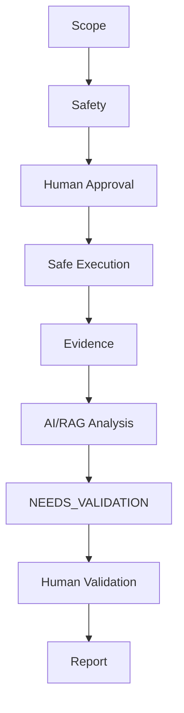
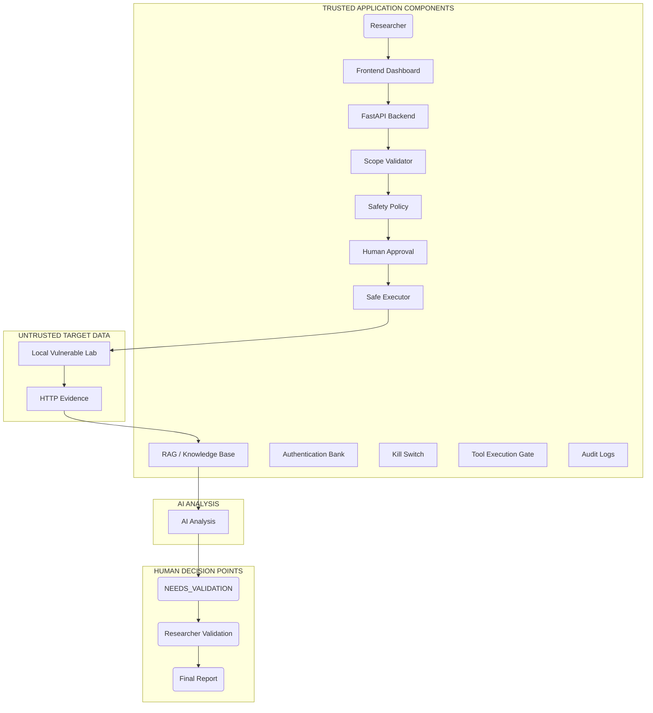
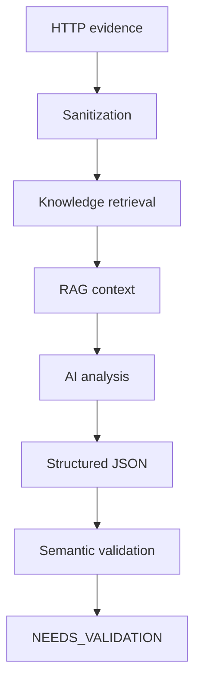

# AI-BugHunter

## Overview
AI-BugHunter is an **AI-assisted security research platform for controlled and authorized vulnerability testing.** 

It is designed as a strict, defensible orchestration layer where Large Language Models (LLMs) act purely as analytical assistants to human researchers. It is **not** an autonomous hacking system. Humans remain in absolute control of the testing lifecycle.

---

## Problem
Modern security testing generates large amounts of HTTP evidence and diagnostic data. Security researchers need efficient, controlled testing workflows, and while AI can significantly accelerate evidence analysis (e.g., parsing headers, identifying payload mutations), AI systems are often unpredictable. If unchecked, they can hallucinate vulnerabilities, violate testing scopes, or inadvertently expose sensitive credentials. AI-BugHunter solves this by ensuring that **security decisions always remain under human researcher control.**

---

## Core Workflow



---

## Key Features

- **Scope validation**: Strictly prevents executing tests outside registered domain boundaries.
- **Controlled test planning**: Tests are formulated and logged before execution.
- **Human approval**: `HIGH_IMPACT` tests pause the pipeline for manual researcher sign-off.
- **Safe execution**: A single choked outbound mechanism (`SafeExecutor`) handles all targeting.
- **Kill switch**: A global state that immediately halts all outbound requests when triggered.
- **Authentication context management**: Structurally isolates API keys and JWTs per program.
- **Credential encryption**: `Fernet` symmetric encryption for stored secrets.
- **Evidence collection**: Immutable logging of exact HTTP requests and responses.
- **AI analysis**: LLM parsing of evidence for contextual insight.
- **RAG knowledge context**: Vector-retrieved policy rules that override hostile target data.
- **Prompt-injection defense**: Wraps hostile evidence in strict block delimiters.
- **AI output validation**: Rejects hallucinatory JSON outputs from the LLM.
- **Human finding validation**: AI cannot mark findings verified; researchers hold the final keys.
- **Audit logging**: Non-repudiable tracking of who authorized tests.
- **Reporting**: Automated JSON/Markdown report compilation for validated findings.
- **Agent/tool security**: Strict multi-agent capability gating (no transitive privileges).
- **Local vulnerable lab**: Included mock environments for safe API evaluation.

*(Note: Features not explicitly listed above are strictly excluded from the scope of this platform.)*

---

## Architecture



---

## Security Architecture

### Scope Enforcement
The `ScopeValidator` compares all dispatched URLs against the explicit `Program` rules. If a URL violates the schema, domain, or path constraints, it is immediately rejected, preventing SSRF and OOB testing.

### Safety Controls
Test payloads are categorized by `TestLevel`. Active, invasive testing logic requires escalation to a higher tier, automatically triggering approval workflows.

### Human Approval
AI cannot automatically execute destructive or `HIGH_IMPACT` payloads. The system forces a hard stop, persisting the `TestPlan` in the database until a human clicks "Approve". 

### Safe Execution
The `SafeExecutor` binds the isolated authentication contexts to the request, applies rate limiting, verifies the `KillSwitch` is disabled, and dispatches the request to the target.

### Kill Switch
A global backend flag. When active, all downstream operations in `SafeExecutor` immediately abort with a `503` error.

### Authentication Contexts
Keys and JWTs are tied to `AuthContexts`. The platform redacts these keys from the raw HTTP evidence (`[REDACTED]`) before the evidence hits the LLM, preventing accidental token leakage to AI providers.

### AI Security
- **Prompt-injection defense**: Hostile HTTP responses are wrapped in `<<<DATA>>>` tags, and the system prompt orders the LLM to ignore embedded commands.
- **Untrusted HTTP data**: Handled as strictly hostile. 
- **RAG trust boundaries**: RAG policies are injected as authoritative rules overriding the evidence.
- **Structured AI output**: Responses are strictly parsed through Pydantic; arbitrary code or unformatted text is rejected.
- **Semantic validation**: Outputs are evaluated to ensure they logically align with the input evidence.

### Human Validation
AI analysis outputs default to `NEEDS_VALIDATION`. The LLM cannot independently mark a vulnerability as legitimate. The final security decision remains with the researcher.

---

## AI / RAG Architecture


The AI analysis is strictly an **assistant function**. It surfaces correlations and generates structured hypotheses, but it **cannot independently confirm vulnerabilities**.

---

## Local Lab
The repository ships with multiple built-in vulnerable labs (`127.0.0.1:9000-9300`), such as `backend/local_ai_lab.py` and `backend/local_agent_lab.py`. These allow researchers to execute the demo and unit tests in a completely authorized, local environment without touching the open internet.

---

## Installation

**Prerequisites:**
- Python 3.10+
- Git

**Installation:**
```bash
git clone https://github.com/yourusername/ai-bughunter.git
cd ai-bughunter
cd backend
pip install -r requirements.txt
```

**Environment configuration:**
(Optional) If you want to use live LLMs instead of the default mock providers:
```bash
export OPENAI_API_KEY="sk-..."
```

**Backend startup:**
The SQLite database automatically initializes on startup.
```bash
python -m uvicorn main:app --host 127.0.0.1 --port 8000
```

**Local lab startup (New Terminal):**
```bash
cd backend
python local_ai_lab.py
```

**Frontend startup (New Terminal):**
```bash
cd frontend
python -m http.server 8080
```

**Testing:**
```bash
python -m pytest tests/unit -v
```

---

## Demo Workflow
This workflow is strictly intended for **authorized/local testing** using the included mock labs.

1. Start application (Backend + Frontend + Local Lab).
2. Create/select a local program (e.g., `http://127.0.0.1:9100`).
3. Create a test plan for the target endpoint.
4. Human researcher reviews and **approves** the test.
5. System **executes** against the local vulnerable lab.
6. System collects HTTP **evidence**.
7. AI **analyzes** the evidence and generates a hypothesis.
8. Finding enters **`NEEDS_VALIDATION`** status.
9. Researcher **validates** the finding to `RESEARCHER_CONFIRMED`.
10. Generate the final **report**.

*(Note: See `scripts/demo/run_demo.py` for the automated CLI version of this exact workflow).*

---

## Security Model
**SCOPE → SAFETY → HUMAN APPROVAL → SAFE EXECUTION → EVIDENCE → AI ANALYSIS → HUMAN VALIDATION → REPORT**

---

## Project Structure
```text
C:.
+---backend
|   |   main.py
|   |   requirements.txt
|   +---ai (Analyzers, Agents, Tool Gates, Providers)
|   +---analyzer (Correlation, Diffing)
|   +---auth_bank (Crypto, Redaction)
|   +---evidence (Immutable Storage)
|   +---models (SQLite Schema)
|   +---observability (Audit Logging)
|   +---rag (Knowledge Retrieval)
|   +---reports (Report Generation)
|   +---scope (Scope Validator)
|   \---testing (SafeExecutor, SafetyPolicy, Planners)
+---demo (Demo Execution Scripts & Output Artifacts)
+---docs (Architecture & Security Models)
+---frontend (Dashboard UI)
+---scripts (Release Automation)
\---tests (Unit & Integration)
```

---

## Testing
Run the test suite using `pytest`:
```bash
python -m pytest tests/unit -v
```
**Current Status:** 37 passing, 6 known fixture infrastructure issues. 
*(Note: The 6 failures are expected fixture-related teardown collisions caused by async SQLite session handling in the test runner. The core security logic successfully passes).*

---

## Limitations
- **No autonomous vulnerability validation**: AI hypotheses must be manually verified.
- **No unrestricted external scanning**: Scope Validator explicitly blocks untested domains.
- **No automatic bug bounty submission**: The platform does not submit reports to external parties.
- **No fully autonomous exploitation**: Execution halts for human intervention on critical impact paths.

---

## Responsible Use
AI-BugHunter is an authorized security research platform. It **must only** be used against:
1. Systems owned explicitly by the researcher.
2. Included local vulnerable mock labs.
3. Targets where explicit, documented authorization for security testing has been granted.
