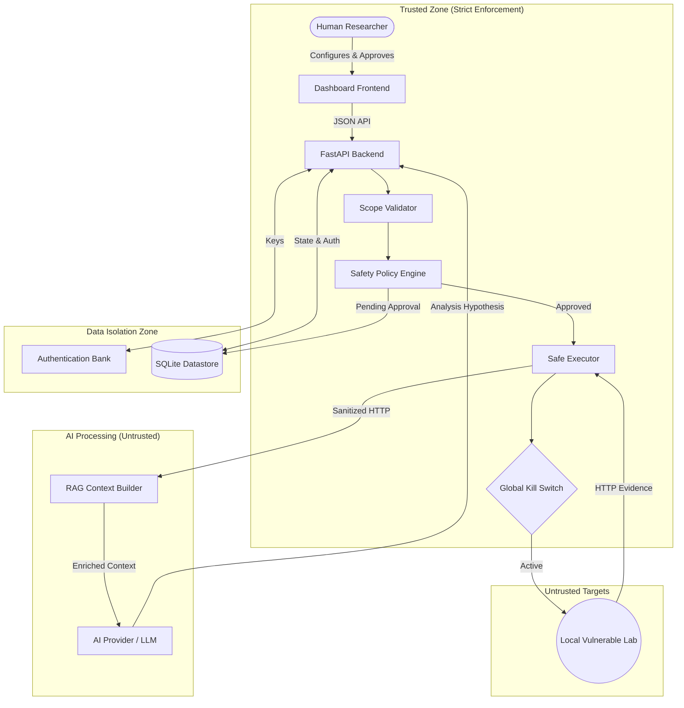
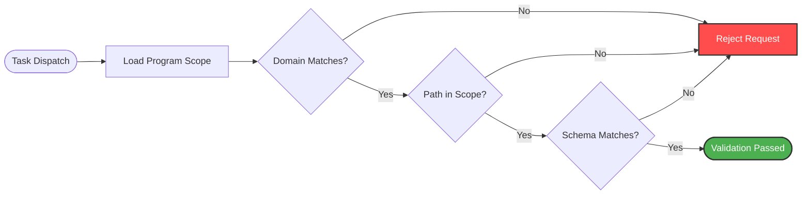
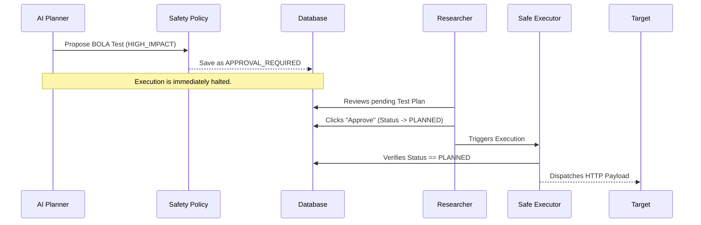
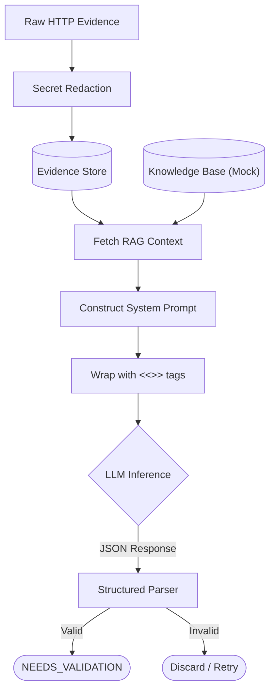
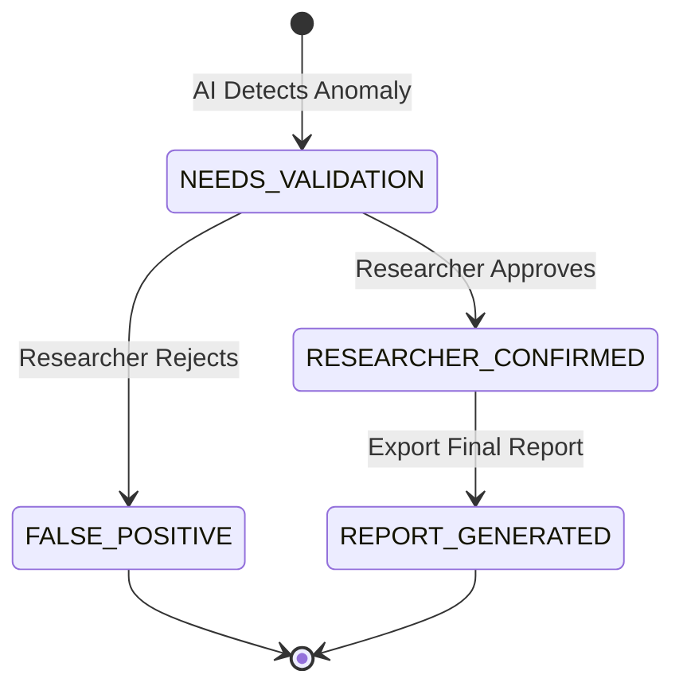

# AI-BugHunter Architecture & Workflows

This document outlines the core architecture, security boundaries, and data flows within AI-BugHunter. These diagrams represent the strict authorization controls that govern AI assistance during security research.

---

## 1. Core Architecture Overview

The system is separated into **Trusted Components** (where policies are enforced) and **Untrusted Components** (where external data and AI generation occurs).

---

## 2. Threat Modeling & Scope Validation

This flowchart details how AI-BugHunter prevents accidental Out-of-Bounds (OOB) requests or unauthorized scanning.

---

## 3. Human-in-the-Loop Approval Workflow

AI-BugHunter strictly enforces that destructive or high-impact tests are explicitly authorized by a human researcher. AI agents cannot autonomously exploit systems.

---

## 4. Evidence Handling & RAG Pipeline

When a test executes, the HTTP evidence is sanitized (secrets redacted) and combined with the internal Knowledge Base before being sent to the AI.

---

## 5. Finding Validation & Reporting Lifecycle

The AI acts as an assistant. It surfaces findings, but they are never considered valid until the human researcher confirms them.

