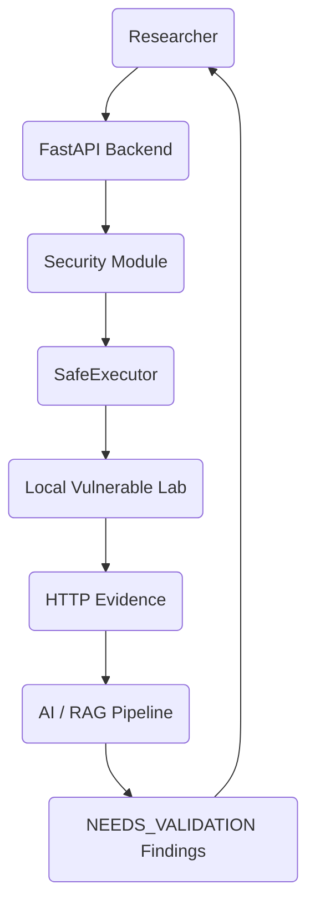
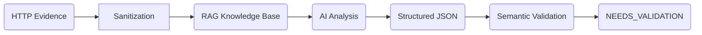

# AI-BugHunter Architecture

## High-Level Architecture
AI-BugHunter is a modern Python backend utilizing FastAPI for REST routing, Pydantic for validation, and SQLAlchemy for SQLite persistence. The architecture separates untrusted target execution from trusted human decision-making and AI semantic analysis.

## Request Flow
1. **Initiation**: The researcher submits a test plan to the backend.
2. **Safety Enforcement**: The `ScopeValidator` and `KillSwitch` intercept the plan.
3. **Approval**: High-impact plans wait in `APPROVAL_REQUIRED`.
4. **Execution**: The `SafeExecutor` dispatches the HTTP request to the target lab.
5. **Storage**: The result is captured immutably.

## Security Boundary
The core boundary strictly separates:
- **TRUSTED**: Researcher approvals, RAG policies, Audit Logs.
- **UNTRUSTED**: Target responses, AI analysis output.
All HTTP responses from the `Local Vulnerable Lab` are considered hostile and are sanitized before AI ingestion.

## AI/RAG Flow

AI acts purely as an assistant. It surfaces patterns and maps them to RAG rules, but it cannot definitively confirm a vulnerability.

## Authentication Flow
Credentials (JWTs, API Keys) are stored encrypted via `Fernet` in the `AuthBank`.
When the `SafeExecutor` dispatches a test, it dynamically attaches the required context (e.g., `Authorization: Bearer <token>`). Any appearance of this token in the response payload is redacted (`[REDACTED]`) before the evidence is stored or sent to the AI.

## Human Validation Flow
AI findings default to `NEEDS_VALIDATION`.
A researcher reviews the HTTP evidence against the AI's hypothesis. Only human-toggled `RESEARCHER_CONFIRMED` findings are included in the final security report.

## Audit Flow
All critical state transitions (Approvals, Executions, Findings validations) write immutable records to the `AuditLog` table. This provides a non-repudiable history of who authorized a test and what the AI concluded.
